<p align="center">
  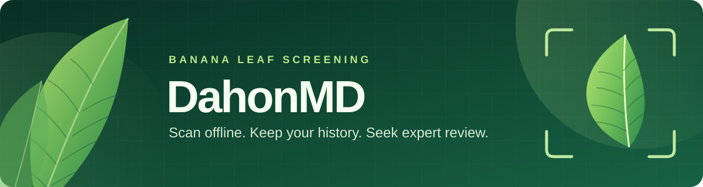
</p>

<h1 align="center">DahonMD · Banana Leaf Disease Scanner</h1>

<p align="center">Scan a banana leaf on an Android phone, keep a local history, and optionally connect with an agriculturist for review.</p>

<p align="center"><code>Android</code> &nbsp; <code>Offline TFLite inference</code> &nbsp; <code>Optional web + API</code> &nbsp; <code>Four leaf classes</code></p>

<p align="center">
  <a href="#at-a-glance"><strong>At a glance</strong></a> &nbsp;·&nbsp;
  <a href="#app-tour"><strong>App tour</strong></a> &nbsp;·&nbsp;
  <a href="#leaf-guide-preview"><strong>Leaf guide</strong></a> &nbsp;·&nbsp;
  <a href="#how-it-works"><strong>How it works</strong></a> &nbsp;·&nbsp;
  <a href="#quick-start"><strong>Quick start</strong></a> &nbsp;·&nbsp;
  <a href="#android-app"><strong>Android app</strong></a> &nbsp;·&nbsp;
  <a href="#explore-the-repository"><strong>Explore the repository</strong></a>
</p>

> [!IMPORTANT]
> DahonMD is a screening and research tool, not laboratory confirmation. Model confidence is not the probability that a plant is diseased.

The Android app classifies a leaf photo **on the phone, without internet**, as **Healthy**, **Sigatoka**, **Panama disease**, or **Cordana leaf spot**. An account, the website, and the API are optional. Signed-in farmers can sync scan records and request expert review; an agriculturist's verdict appears alongside the original AI result. Research use of a private photo requires separate consent.

## At a glance

<table>
  <tr>
    <td align="center" width="25%"><strong>01 · Offline scanning</strong><br><sub>Camera or gallery photo → bundled four-class model</sub></td>
    <td align="center" width="25%"><strong>02 · Local history</strong><br><sub>Completed scans stay on the phone</sub></td>
    <td align="center" width="25%"><strong>03 · Expert review</strong><br><sub>Optional farmer requests and agriculturist verdicts</sub></td>
    <td align="center" width="25%"><strong>04 · Connected workspace</strong><br><sub>Optional website, accounts, sync, and administration</sub></td>
  </tr>
</table>

## App tour

These are **unedited 1080 × 2400 screenshots from the installed DahonMD Android app**, captured through USB debugging on a realme RMX2151 on November 17, 2026. They use the seeded demo farmer account connected to the local test server over USB. Select an image to open it at full size. The [capture archive](docs/screenshots/app-2026-11-17/README.md) records the device, method, and file hashes.

<table>
  <tr>
    <td align="center"><a href="docs/screenshots/app-2026-11-17/01-home.webp">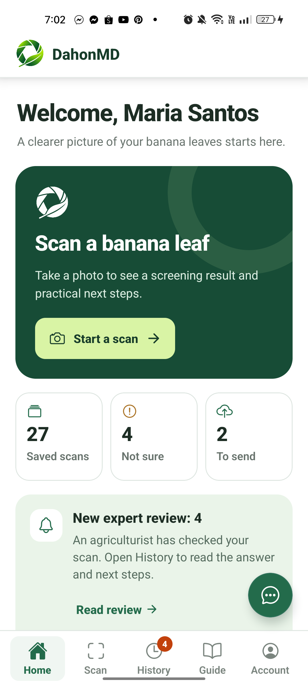</a><br><strong>1 · Home</strong><br><sub>Start a scan and see what needs attention</sub></td>
    <td align="center"><a href="docs/screenshots/app-2026-11-17/02-scan.webp">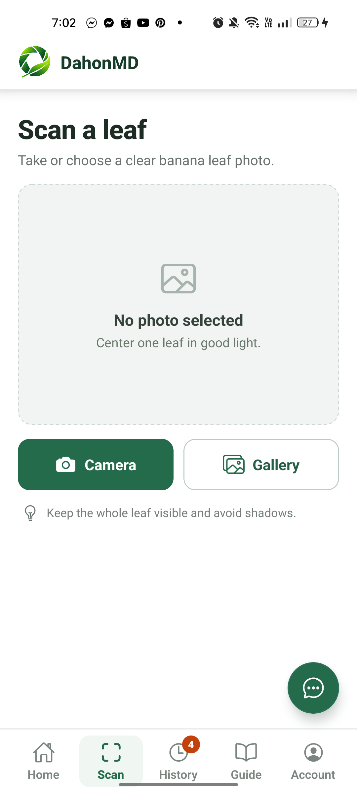</a><br><strong>2 · Scan</strong><br><sub>Camera or gallery photo</sub></td>
    <td align="center"><a href="docs/screenshots/app-2026-11-17/03-history.webp">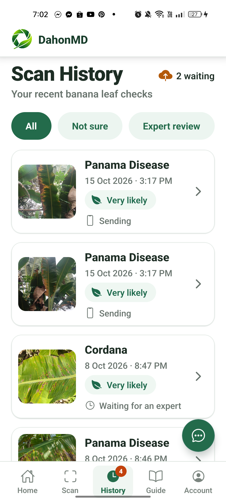</a><br><strong>3 · History</strong><br><sub>Saved results and send status</sub></td>
  </tr>
  <tr>
    <td align="center"><a href="docs/screenshots/app-2026-11-17/04-expert-review.webp">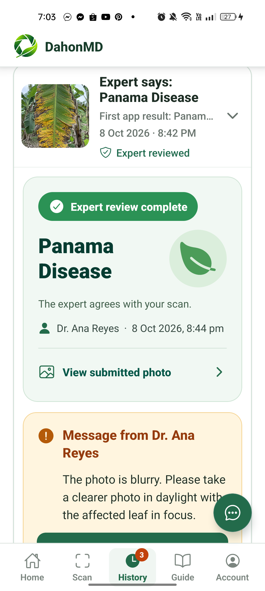</a><br><strong>4 · Expert review</strong><br><sub>An agriculturist's verdict and advice</sub></td>
    <td align="center"><a href="docs/screenshots/app-2026-11-17/05-guide.webp">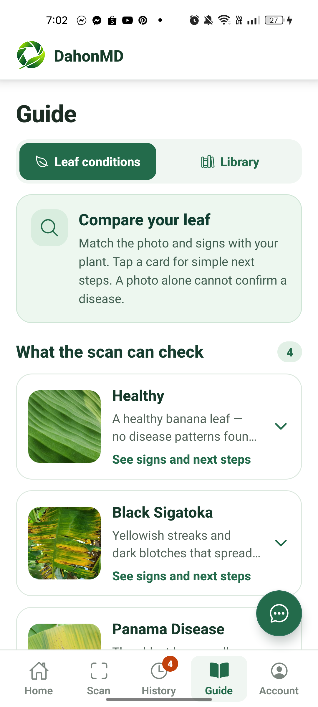</a><br><strong>5 · Guide</strong><br><sub>Compare your leaf with each condition</sub></td>
    <td align="center"><a href="docs/screenshots/app-2026-11-17/06-library.webp">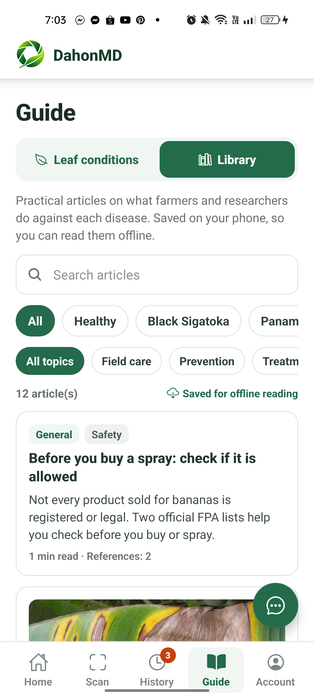</a><br><strong>6 · Library</strong><br><sub>Practical articles, readable offline</sub></td>
  </tr>
</table>

The [sign-in screen](docs/screenshots/app-2026-11-17/07-sign-in.webp) and the [Ask Dahon chat](docs/screenshots/app-2026-11-17/08-ask-dahon.webp) for general leaf questions are also available.

## Leaf guide preview

The disease guide includes representative leaf images for the four classes. These are educational examples, not a diagnosis of a new photo. [Image sources and licenses](web-frontend/public/assets/disease-guide/README.md) are recorded beside the assets.

<table>
  <tr>
    <td align="center"><a href="web-frontend/public/assets/disease-guide/healthy-1.webp"></a><br><strong>Healthy</strong></td>
    <td align="center"><a href="web-frontend/public/assets/disease-guide/sigatoka-1.webp">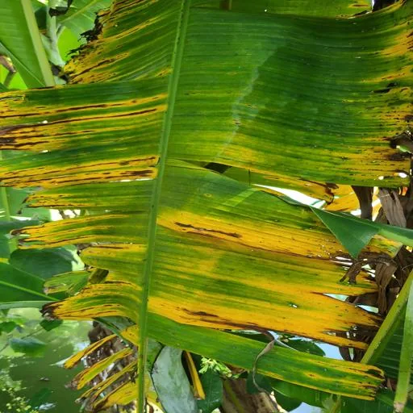</a><br><strong>Sigatoka</strong></td>
    <td align="center"><a href="web-frontend/public/assets/disease-guide/panama-stages/02-expanding-chlorosis/panama-leaf-stage-2.webp">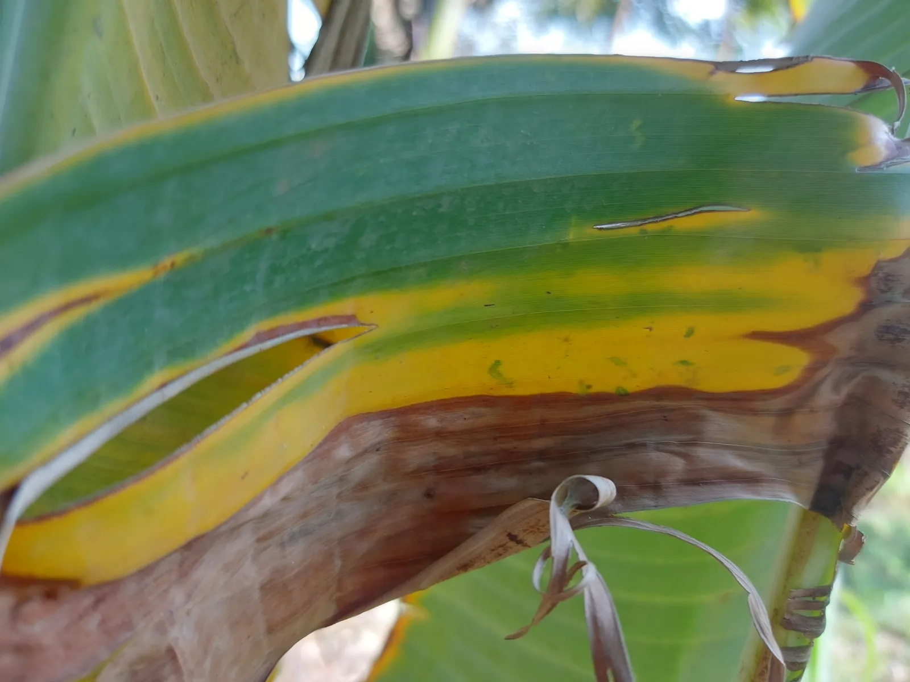</a><br><strong>Panama disease</strong></td>
    <td align="center"><a href="web-frontend/public/assets/disease-guide/cordana-1.webp">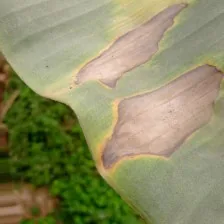</a><br><strong>Cordana leaf spot</strong></td>
  </tr>
</table>

## How it works

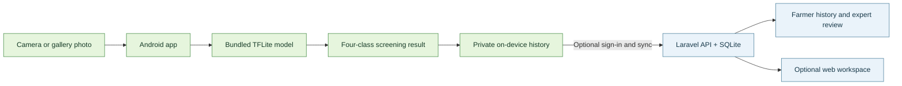

The classification path runs entirely on Android. Connected services handle accounts, shared history, review, and administration **after** a local prediction. A phone result remains client-reported to the API even when the on-device model ran successfully; the optional web inference route can attach a separate server-verifiable receipt. The [architecture overview](docs/architecture/overview.md) explains both paths.

## Quick start

Run these commands in **Windows PowerShell** from the project folder:

```powershell
Set-Location 'C:\Users\feann\OneDrive\Documents\Banana-Leaf-Disease-Scanner'
powershell.exe -NoProfile -ExecutionPolicy Bypass -File .\start-free-test.ps1
```

This starts the test backend and website. With an authorized USB-debugging phone connected, it installs the test APK and connects the app directly over USB. Without a phone, it creates a temporary Cloudflare HTTPS link and shows a QR code. Open the link on the phone and tap **Open DahonMD app**; the offline scanner itself does not need a server.

| Command | What it does |
| --- | --- |
| `.\start-free-test.ps1` | Start or restart; use USB when a phone is connected, otherwise Cloudflare |
| `.\start-free-test.ps1 -Stop` | Stop the tunnel, website, and backend |
| `.\start-free-test.ps1 -NoOpen` | Leave the browser and QR code closed |
| `.\start-free-test.ps1 -SkipPhone` | Start the website without touching the phone |
| `.\start-free-test.ps1 -ForceApkBuild` | Rebuild the test APK even if mobile code is unchanged |
| `.\start-free-test.ps1 -UsbOnly` | Require a direct USB phone connection |
| `.\start-free-test.ps1 -Cloudflare` | Request a public HTTPS link even when a USB phone is connected |

### USB phone connection

Keep the phone unlocked and authorize USB debugging. The script builds and installs a test APK, sets up ADB reverse, and sends `http://127.0.0.1:4174` to the app. Wait for **Server connected**, then sign in again. Keep the cable attached for connected features; offline scanning continues after disconnecting. This loopback HTTP address is accepted only by the USB test APK.

To require USB mode:

```powershell
powershell.exe -NoProfile -ExecutionPolicy Bypass -File .\start-free-test.ps1 -UsbOnly
```

### Restart a Cloudflare link

The free link changes on every run and stops working when the tunnel stops. The app signs out when the server address changes.

```powershell
powershell.exe -NoProfile -ExecutionPolicy Bypass -File .\start-free-test.ps1 -Stop
powershell.exe -NoProfile -ExecutionPolicy Bypass -File .\start-free-test.ps1 -Cloudflare
```

Wait for the printed `Website and phone server: https://…` line. If port 8002 or 4174 is busy, inspect it with `Get-NetTCPConnection -LocalPort 8002,4174 -State Listen | Select-Object LocalPort, OwningProcess`. The script retries Cloudflare over HTTP/2 and QUIC and checks the public API. Tunnel errors are in `.dahonmd\free-test\tunnel-*.err.log`.

Test data stays in `.dahonmd\free-test\` between runs. Startup applies pending backend migrations to this isolated database; emails are written only to the log. Keep the computer on while using the link. See the [automation guide](AUTOMATION_README.md) and [demo walkthrough](DEMO_WALKTHROUGH.md) for more detail.

## Android app

First build (Node.js 22.13+ and an Android emulator or USB-debugging phone required):

```powershell
cd mobile-frontend
npm install
npm run release:status
npx expo prebuild --clean --platform android
npm run android
```

For later runs, use `npm run android` from `mobile-frontend/`. Expo Go cannot load the custom on-device model module. After an Expo upgrade or native configuration change, repeat `npm install` and `npx expo prebuild --clean --platform android`.

To build a shareable test APK:

```powershell
cd mobile-frontend\android
.\gradlew.bat assembleRelease
```

Output: `mobile-frontend\android\app\build\outputs\apk\release\app-release.apk`. It is debug-signed for testing and demos, not for the Play Store. The APK includes only `arm64-v8a` and `armeabi-v7a`, about 70 MB instead of about 130 MB. Because `android/` is regenerated by `expo prebuild --clean`, set `reactNativeArchitectures=armeabi-v7a,arm64-v8a` in `android/gradle.properties` again afterward. For an emulator, build with `.\gradlew.bat assembleRelease -PreactNativeArchitectures=x86_64`.

## Website and API

The website and Laravel API are optional connected utilities. With Docker:

```powershell
docker compose up --build  # first time
docker compose up          # later
docker compose down        # stop
```

Open <http://localhost:4173>.

Without Docker, install PHP 8.2+, Composer, and Node.js. Set up the API once:

```powershell
cd backend
composer install
if (-not (Test-Path .env)) { Copy-Item .env.example .env }
php artisan key:generate
if (-not (Test-Path database/database.sqlite)) { New-Item database/database.sqlite -ItemType File }
php artisan migrate --seed
```

Then run these in separate terminals:

```powershell
# Terminal 1: API
cd backend
php artisan serve --host=0.0.0.0 --port=8001
```

```powershell
# Terminal 2: website
cd web-frontend
npm install
npm run dev -- --host 127.0.0.1 --port 4173
```

Open <http://127.0.0.1:4173>. Docker and the manual API setup both use port 8001, so run one at a time.

### Demo accounts

`php artisan migrate --seed` creates these accounts for local demos. The password is `DahonMD@2026` unless `DEV_USER_PASSWORD` overrides it. They are not production accounts.

| Email | Role |
| --- | --- |
| `admin@dahonmd.test` | Administrator |
| `agriculturist@dahonmd.test` | Agriculturist |
| `maria.santos@dahonmd.test` | Farmer |

## Explore the repository

| Area | Start here | What you will find |
| --- | --- | --- |
| Android app | [mobile-frontend/](mobile-frontend/README.md) | Expo / React Native UI, local history, and on-device TFLite inference |
| Website | [web-frontend/](web-frontend/README.md) | React / Vite farmer and staff experiences |
| API and database | [backend/](backend/README.md) | Laravel, SQLite, accounts, sync, and review |
| Model pipeline | [ai/](ai/README.md) · [experiments](MODEL_EXPERIMENTS.md) | Training, evaluation, and model conversion |
| Dataset | [datasets/](datasets/README.md) | Four-class dataset workspace and provenance |
| Documentation | [docs/](docs/README.md) | Architecture, role flows, scientific guidance, and deployment notes |
| Screenshots | [phone capture archive](docs/screenshots/app-2026-11-17/README.md) | Installed Android app screens with device, method, and hashes |

## Updating and checking

The deployed phone model is `ca_mobilenetv3_small_fp32.tflite` (PILOT-06 seed 42). Its locked-test macro-F1 is **0.96645** and accuracy is **0.96644**. See the [AI guide](ai/README.md) and [GPU training guide](ai/training/GPU_TRAINING_GUIDE.md) for the evaluation contract and training history.

For the optional thesis comparison panel, start the service with:

```powershell
.venv\Scripts\python.exe -m uvicorn ai.deployment.comparison_service:app --host 127.0.0.1 --port 8100
```

Run the local checks from the repository root:

```powershell
cd backend; php artisan test; cd ..
npm --prefix web-frontend run build
npm --prefix mobile-frontend test
npm --prefix mobile-frontend run typecheck
.venv\Scripts\python.exe -m unittest discover -s ai\tests -v
```

### Common problems

| Problem | Fix |
| --- | --- |
| PowerShell says running scripts is disabled | Run `Set-ExecutionPolicy -Scope Process Bypass` first |
| Phone says the request could not be completed | Restart Cloudflare and reconnect the phone; the link may have changed |
| Port already in use | Stop the other process or run `.\start-free-test.ps1 -Stop` |
| Expo Go opens but cannot classify | Build the native app with `npm run android` |
| No Android device found | Start an emulator or connect and authorize a USB-debugging phone |
| Website says `Failed to fetch` | Check that the API is running and only one local server setup is active |

## Scientific limits

- `sigatoka` covers Black and Yellow Sigatoka; the model does not distinguish them.
- `healthy` is not proof that a plant is disease-free. Panama disease needs field or laboratory confirmation.
- Chemical advice is shown only with current Philippine regulatory evidence.
